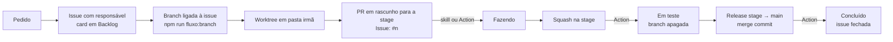

# Fluxo de tarefa com GitHub Projects

Como uma tarefa anda do pedido até a produção, com o quadro do GitHub Projects fazendo o papel de
Jira. É o GitHub Flow com uma branch de homologação no lugar da `develop`. Vale para quem trabalha
com o Claude Code (a skill `fluxo-de-tarefa` faz os passos) e para quem trabalha sem ele (os
mesmos passos à mão).

Neste texto a branch de homologação se chama `stage`: é a branch que publica o ambiente de teste
antes da release. No seu projeto ela pode ter outro nome (`develop`, `homolog`, `staging`); troque
onde a seção "Como adaptar" indica.

## A regra

| O que fazer                                                                                  | Problema que evita                                                     | Onde é imposta                                        |
| -------------------------------------------------------------------------------------------- | ---------------------------------------------------------------------- | ----------------------------------------------------- |
| Toda tarefa que muda o repositório tem uma issue com responsável e um card no quadro         | Trabalho invisível, backlog que não bate com o que está sendo feito    | Skill `fluxo-de-tarefa`; convenção para quem não usa  |
| A branch nasce ligada à issue (`npm run fluxo:branch`)                                       | PR que ninguém acha a partir da issue                                  | Script `scripts/fluxo/branch-da-issue.mjs`            |
| Uma worktree por tarefa, em pasta irmã; o checkout principal fica na `stage`                 | `stash` e troca de branch no meio do trabalho; duas tarefas misturadas | Convenção, sem imposição                              |
| PR em rascunho para a `stage` aberto no início, com `Issue: #<n>` na primeira linha do corpo | Card sem link para o código; Action sem saber qual issue mover         | Action `Projects` (só move o que a linha cita)        |
| Título do PR em Conventional Commits; merge na `stage` com squash                            | Versão errada na release: o título vira o commit que decide o bump     | `semantic-release` na `main` (ver `rules/release.md`) |
| O card anda sozinho: Fazendo no PR, Em teste no squash, Concluído na release                 | Quadro desatualizado porque alguém esqueceu de arrastar o card         | Action `.github/workflows/projects.yml`               |

Pedido que não mexe no repositório (pergunta, análise, consulta a painel) não abre branch, issue
nem card.

## Montar o quadro

Uma vez, por alguém com permissão de administrador na organização.

1. **Crie o projeto** na organização (`https://github.com/orgs/<org>/projects` → New project,
   layout Board). Anote o número que aparece na URL: é o `<número do quadro>`.
2. **Ligue o repositório** ao projeto (no repositório: Projects → Link a project). Issues e PRs
   do repositório passam a poder entrar no quadro.
3. **Campo `Status`** (seleção única) com quatro opções, nesta ordem:

   | Coluna    | Quando o card está aqui                                       | Quem move                            |
   | --------- | ------------------------------------------------------------- | ------------------------------------ |
   | Backlog   | A tarefa existe, ninguém começou                              | quem cria a issue                    |
   | Fazendo   | Há branch e PR em rascunho para a `stage`                     | quem começa (ou a Action no PR)      |
   | Em teste  | O PR entrou na `stage`: está em homologação, antes da release | Action `Projects`                    |
   | Concluído | A release (`stage → main`) publicou a mudança                 | Action `Projects`, que fecha a issue |

4. **Campos extras do quadro:**

   | Campo   | Tipo          | Uso                                                                                                |
   | ------- | ------------- | -------------------------------------------------------------------------------------------------- |
   | `Prazo` | Data          | Data combinada, opcional; o mesmo valor vai no `Target date` da issue                              |
   | `Fase`  | Seleção única | Agrupa o backlog (por exemplo, `Nova`, `Próximo ciclo`, `Dívida`, `Higiene`); `Nova` é obrigatória |

5. **Desligue os workflows embutidos do quadro** que mudam `Status` ao fechar ou mergear (em
   Workflows: "Item closed" e "Pull request merged"). Eles levam o card para a coluna final no
   merge na `stage` e pulam o Em teste. Quem move o card é a Action.
6. **Labels no repositório:** `enhancement`, `bug` e `documentation` já existem por padrão; crie
   `chore`, `refactor`, `test`, `ci` e `perf`.
7. **Tipos e campos de issue da organização:** os tipos `Feature`, `Bug` e `Task` e os campos
   `Priority`, `Effort`, `Start date` e `Target date`. Confira quais existem com as ferramentas
   `list_issue_types` e `list_issue_fields` do MCP do GitHub. O que a organização não tiver sai da
   tabela "Campos preenchidos" da skill.

## Ciclo de uma tarefa



1. **Issue.** Antes de mexer no código, procure a issue no quadro. Existe: use. Não existe: crie
   uma, com você como responsável e o corpo com Objetivo, Escopo e Andamento. Pode começar quase
   vazia.
2. **Branch ligada à issue**, a partir da `stage`:

   ```bash
   npm run fluxo:branch -- <issue> <tipo>/<issue>-<slug>
   ```

   É o mesmo que o botão "Create a branch" da issue: a branch aparece na seção "Development" da
   issue, e o PR aberto dela fica ligado à issue. O `<tipo>` é o do Conventional Commits (`feat`,
   `fix`, `chore`, `docs`, `refactor`, `test`, `ci`, `perf`). O script usa a credencial do git
   (ou `GITHUB_TOKEN`) e só precisa do escopo `repo`.

3. **Worktree.** O checkout principal fica sempre na `stage`. Cada tarefa ganha uma worktree numa
   pasta irmã, fora do repositório:

   ```bash
   git fetch origin <branch>
   git worktree add ../<repo>-worktrees/<tipo>-<issue>-<slug> <branch>
   ```

   Para rodar o app, os testes ou o build na worktree: `npm ci` e uma cópia do `.env` do checkout
   principal. Worktree de tarefa que já entrou na `stage` é removida (`git worktree remove`) junto
   com a branch local.

4. **PR em rascunho** para a `stage`, aberto no início (com um commit vazio
   `chore: inicia #<issue>` se ainda não houver diferença). Título em Conventional Commits; a
   primeira linha do corpo é `Issue: #<issue>`, e é ela que a Action lê. O PR tem você como
   responsável e entra no quadro também: **issue e PR ficam os dois em Fazendo**.
5. **Durante o trabalho**, issue e PR são atualizados a cada avanço: o que foi decidido, o que
   mudou, como testar. Commits em Conventional Commits.
6. **Pronto para teste.** O portão único passa, o PR sai do rascunho e é mergeado na `stage` com
   **squash**. A Action move os cards da issue e do PR para **Em teste** e apaga a branch.
7. **Release.** PR `stage → main` com merge commit (`rules/release.md`). Ao entrar na `main`, a
   Action move tudo que estava em Em teste para **Concluído** e fecha as issues.

Correção urgente direto na `main` segue o mesmo desenho, com a branch ligada saindo da `main`
(`npm run fluxo:branch -- <issue> fix/<issue>-<slug> main`) e o PR apontando para ela; depois
faz-se o back-merge na `stage`.

## Campos preenchidos

O fluxo preenche a lateral da issue e do PR no início da tarefa. Só Reviewers e Milestone ficam
de fora.

| Campo         | Onde       | Valor                                                                                                                                |
| ------------- | ---------- | ------------------------------------------------------------------------------------------------------------------------------------ |
| Assignees     | issue e PR | quem faz a tarefa                                                                                                                    |
| Type          | issue      | `feat` → Feature; `fix` → Bug; os demais tipos → Task                                                                                |
| Labels        | issue e PR | `feat` → `enhancement`; `fix` → `bug`; `docs` → `documentation`; `chore`, `refactor`, `test`, `ci`, `perf` → label de mesmo nome     |
| Priority      | issue      | a que o desenvolvedor informar no início; sem informação, Medium                                                                     |
| Effort        | issue      | estimativa pelo escopo: Low (horas), Medium (um dia), High (mais que isso)                                                           |
| Start date    | issue      | o dia em que a tarefa começa                                                                                                         |
| Target date   | issue      | o prazo, se houver; o mesmo valor vai no campo `Prazo` do quadro                                                                     |
| Projects      | issue e PR | o quadro, com `Status` e `Fase`; `Prazo` na issue                                                                                    |
| Relationships | issue      | "blocked by" quando depende de outra issue (`npm run fluxo:depende -- <issue> <bloqueadora>`); sub-issue quando é parte de uma maior |
| Development   | issue      | a branch ligada (`npm run fluxo:branch`), com o PR dentro                                                                            |

## Por que assim

- **Uma worktree por tarefa:** duas tarefas abertas (uma esperando revisão, outra em andamento)
  sem `stash` nem troca de branch, e o checkout principal limpo na `stage` para puxar atualizações
  e rodar a versão de referência. Fica fora do repositório porque bundler, runner de testes e
  busca do agente varreriam as cópias duplicadas do código.
- **Squash na `stage`:** um commit por tarefa, com a mensagem do título do PR. É isso que o
  `semantic-release` lê na `main` para decidir a versão, então o título do PR precisa estar certo
  (`feat:` gera minor, `fix:` gera patch, `chore:` não gera).
- **Branch ligada e `Issue: #<n>` em vez de `Closes #<n>`:** palavra de fechamento só liga e fecha
  a issue quando o PR aponta para a branch padrão. Com o PR indo para a `stage`, quem liga issue e
  PR é a branch criada pela issue, e quem move o card é a Action, que lê só a linha `Issue: #<n>`
  no começo de uma linha e as palavras de fechamento. Uma menção solta a outra issue não move nada.
- **PR aberto no início:** o card mostra desde o primeiro minuto onde o trabalho está, e quem olha
  o quadro chega ao código em um clique.

## Automação

### Action `Projects`

`.github/workflows/projects.yml` (modelo em `rules/ci/projects.yml`) roda em todo PR para a
`stage` ou a `main`:

| Evento                                 | O que faz                                                                                                                     |
| -------------------------------------- | ----------------------------------------------------------------------------------------------------------------------------- |
| PR aberto, reaberto, editado ou pronto | A issue da linha `Issue: #n` (ou de `Closes`/`Fixes`/`Resolves #n`) e o próprio PR, se estiverem em Backlog, vão para Fazendo |
| PR mergeado na `stage`                 | A issue e o PR vão para Em teste; a branch do PR é apagada                                                                    |
| PR mergeado na `main`                  | Toda issue e todo PR em Em teste vão para Concluído; as issues são fechadas                                                   |

A Action localiza o card de cada issue e PR pelo próprio item (`projectItems` da issue), não pela
listagem do quadro. A action do GitHub está presa por SHA e o workflow só tem
`permissions: contents: read`: quem escreve no quadro e apaga a branch é o `PROJECTS_TOKEN`.

### Scripts

| Comando                                              | Script                              | O que faz                                                                                                  |
| ---------------------------------------------------- | ----------------------------------- | ---------------------------------------------------------------------------------------------------------- |
| `npm run fluxo:branch -- <issue> <nome> [base]`      | `scripts/fluxo/branch-da-issue.mjs` | Cria a branch no GitHub já ligada à issue (`createLinkedBranch`), a partir da `stage` ou da base informada |
| `npm run fluxo:depende -- <issue> <bloqueadora> […]` | `scripts/fluxo/depende-de.mjs`      | Registra "blocked by" (`addBlockedBy`)                                                                     |
| (biblioteca)                                         | `scripts/fluxo/github.mjs`          | Lê o token de `GITHUB_TOKEN` ou do `git credential fill`; descobre dono e repositório pelo `origin`        |

No `package.json`:

```json
"fluxo:branch": "node scripts/fluxo/branch-da-issue.mjs",
"fluxo:depende": "node scripts/fluxo/depende-de.mjs"
```

Exigem Node 18 ou mais novo (`fetch` global) e o git autenticado no github.com por HTTPS, ou
`GITHUB_TOKEN` no ambiente.

### Skill `fluxo-de-tarefa`

Modelo em `claude/skills/fluxo-de-tarefa/SKILL.md`, destino `.claude/skills/fluxo-de-tarefa/` do
projeto, carregada por qualquer pessoa que rode o Claude Code no repositório. Dispara quando
alguém pede algo que muda o repositório e faz os passos 1 a 6 do ciclo, perguntando
(opcionalmente) prazo, objetivo e prioridade. Também cobre "sobe pra stage" e a release.

## Configuração

### No repositório (uma vez)

Em Settings → Secrets and variables → Actions:

| Secret           | Para quê                                                                                                                                   |
| ---------------- | ------------------------------------------------------------------------------------------------------------------------------------------ |
| `PROJECTS_TOKEN` | A Action mover os cards e apagar a branch. Token pessoal clássico com `repo` e `project`, de alguém com acesso de escrita ao quadro. Vence |

O `GITHUB_TOKEN` padrão do workflow não alcança projetos da organização. Sem o secret, a Action só
avisa e os cards são movidos à mão.

O token clássico vence. Abra uma issue de renovação com `Target date` uma semana antes do
vencimento; quando chegar, gere outro e troque o secret.

**Alternativa sem token pessoal: GitHub App.** Crie um App na organização com as permissões
"Projects" (organização, leitura e escrita), "Issues", "Pull requests" e "Contents" (repositório,
leitura e escrita), instale no repositório e guarde o App ID e a chave privada como secrets. No
workflow, gere o token antes do passo `Mover cards`:

```yaml
- name: Token do App
  id: app
  uses: actions/create-github-app-token@<sha>
  with:
    app-id: ${{ secrets.PROJECTS_APP_ID }}
    private-key: ${{ secrets.PROJECTS_APP_KEY }}
    owner: <org>
```

e use `github-token: ${{ steps.app.outputs.token }}`. O token do App dura uma hora, não vence no
calendário e não depende de uma pessoa continuar na organização. Pine a action por SHA.

### Por desenvolvedor

| O quê                        | Para quê                                                    | Como                                                                                      |
| ---------------------------- | ----------------------------------------------------------- | ----------------------------------------------------------------------------------------- |
| Acesso de escrita ao repo    | Criar branch, fazer push e abrir PR                         | Conta na organização e o git autenticado (HTTPS para o `fluxo:branch`)                    |
| `.env` em cada worktree      | Rodar o app, os testes e o build na worktree                | Copiar do checkout principal                                                              |
| MCP do GitHub no Claude Code | A skill criar issue, PR e card no nome de quem fez a tarefa | Token clássico pessoal com `repo`, `project` e `read:org`, instalado com o comando abaixo |

```bash
claude mcp add --transport http --scope user github https://api.githubcopilot.com/mcp -H "Authorization: Bearer <token>" -H "X-MCP-Toolsets: projects,issues,repos,pull_requests"
```

Rode no terminal, fora do Claude Code, e reinicie o Claude Code. `claude mcp get github` deve
mostrar `Connected`. Se a organização usa SSO, autorize o token para ela. O token é de cada um e
fica só na máquina; nunca no repositório.

O login OAuth do servidor remoto do GitHub não funciona no Claude Code (o GitHub não oferece
registro dinâmico de cliente), por isso o token.

## Limitações e armadilhas

| Sintoma                                                | Causa                                                                                                   | O que fazer                                                                             |
| ------------------------------------------------------ | ------------------------------------------------------------------------------------------------------- | --------------------------------------------------------------------------------------- |
| O "Development" do PR fica vazio                       | O GitHub só liga PR e issue por `Closes #n` em PR para a branch padrão, e não tem API de vínculo manual | Nada: o vínculo existe pela branch ligada (visível na issue) e pela linha `Issue: #<n>` |
| Card não anda em quadro recém-criado                   | A listagem de itens de um quadro novo atrasa                                                            | A Action procura o card pela issue (`projectItems`), não pela listagem; não troque isso |
| Card vai direto para Concluído no merge na `stage`     | Workflow embutido "Pull request merged" ou "Item closed" ligado no quadro                               | Desligue os dois                                                                        |
| Action falha com `Bad credentials`                     | `PROJECTS_TOKEN` venceu                                                                                 | Gere outro token e troque o secret; ou migre para GitHub App                            |
| Action falha com `coluna "…" não existe`               | Alguém renomeou uma opção do `Status`                                                                   | Ajuste as variáveis `COLUNA_*` do workflow ou volte o nome                              |
| Cards não andam em PR de fork                          | Evento `pull_request` de fork não recebe secrets                                                        | Mova à mão; o fluxo pressupõe branches no próprio repositório                           |
| Issue errada vai para Em teste                         | Corpo do PR com `Fixes #n` ou `Issue: #n` citando outra issue                                           | Cite outras issues sem a palavra de fechamento e fora do começo da linha                |
| Release com versão errada                              | Título do PR em formato errado; o squash usa o título como commit                                       | Ajuste o título antes do merge quando a natureza da tarefa mudar                        |
| `git branch -d` recusa apagar a branch depois do merge | O squash não deixa a branch como ancestral da `stage`                                                   | `git branch -D`                                                                         |
| Testes ou bundler lentos, resultados duplicados        | Worktree criada dentro do repositório                                                                   | Worktree sempre em `../<repo>-worktrees/`                                               |
| A skill pula o fluxo em silêncio                       | MCP do GitHub não conectado                                                                             | A skill avisa e aponta a configuração; confira com `claude mcp get github`              |

## Como adaptar

| O que muda no seu projeto                     | Onde mudar                                                                                                                                |
| --------------------------------------------- | ----------------------------------------------------------------------------------------------------------------------------------------- |
| Organização e número do quadro                | `ORGANIZACAO` e `NUMERO_DO_QUADRO` em `projects.yml`; `<org>`, `<repo>`, `<número do quadro>`, `<nome do quadro>` e `<produto>` na skill  |
| Nome da branch de homologação                 | `branches:` e `BRANCH_DE_HOMOLOGACAO` em `projects.yml`; `BRANCH_DE_HOMOLOGACAO` em `branch-da-issue.mjs`; toda menção a `stage` na skill |
| Nome da branch principal                      | `branches:` e `BRANCH_PRINCIPAL` em `projects.yml`                                                                                        |
| Nomes das colunas                             | Opções do campo `Status` e variáveis `COLUNA_*` em `projects.yml`                                                                         |
| Quadro de usuário, não de organização         | Na Action, troque `organization(login: $org)` por `user(login: $org)`                                                                     |
| Sem campos de issue na organização            | Apague as linhas `Priority`, `Effort`, `Start date` e `Target date` das tabelas                                                           |
| Sem homologação (PR direto na `main`)         | Use `Closes #n` em vez de `Issue: #n`; a coluna Em teste e o squash na homologação deixam de existir                                      |
| Comando do portão único não é `npm run build` | Seção "Sobe pra stage" da skill                                                                                                           |
| Documento de release em outro caminho         | `docs/release.md` na skill (seções de abertura e "Release")                                                                               |

## Registro no `CLAUDE.md`

Cole e adapte na seção de fluxo do `CLAUDE.md` do projeto:

```markdown
## Fluxo de trabalho

Toda tarefa que muda o repositório segue [`docs/fluxo-de-trabalho.md`](docs/fluxo-de-trabalho.md),
e a skill `fluxo-de-tarefa` (`.claude/skills/`) executa o roteiro: no início, uma worktree em
`../<repo>-worktrees/` com a branch `<tipo>/<issue>-<slug>` criada já ligada à issue
(`npm run fluxo:branch`) a partir da `stage` (o checkout principal fica sempre na `stage`), issue
e PR com o responsável, PR em rascunho para a `stage` com `Issue: #<n>` na primeira linha do corpo
e os cards da issue e do PR em **Fazendo**; durante, issue e PR atualizados a cada avanço; no fim,
squash na `stage` (card em **Em teste**, branch apagada) e, na release, card em **Concluído** com
a issue fechada pela Action `Projects`. Título do PR e commits em Conventional Commits: o título
vira o commit do squash e decide a versão. Evita trabalho fora do quadro, PR sem issue e backlog
desatualizado. Imposto pela Action `.github/workflows/projects.yml` (movimento dos cards); o resto
é convenção. Pedido que não mexe no repositório não abre nada disso.
```

E, no `README.md`, uma seção "Comece aqui" com três itens: o quadro e o ciclo da tarefa, o wiki
automático (se adotado, ver `rules/wiki-automatica.md`) e a tabela do que configurar na máquina e
no repositório.

## Arquivos

| No kit                                   | No projeto                                |
| ---------------------------------------- | ----------------------------------------- |
| `rules/fluxo-de-trabalho.md` (adaptado)  | `docs/fluxo-de-trabalho.md`               |
| `claude/skills/fluxo-de-tarefa/SKILL.md` | `.claude/skills/fluxo-de-tarefa/SKILL.md` |
| `rules/ci/projects.yml`                  | `.github/workflows/projects.yml`          |
| `scripts/fluxo/*.mjs`                    | `scripts/fluxo/`                          |
