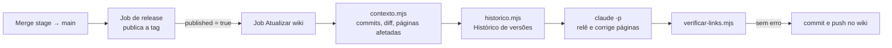

# Wiki atualizado automaticamente a cada release

O wiki do GitHub do repositório como camada de leitura do projeto: explica o que o sistema faz e
por quê, para pessoas e para agentes de IA, e aponta onde cada coisa mora. A fonte da verdade
continua sendo o repositório (código, `docs/` e `CLAUDE.md`). A cada release, um job do CI relê as
páginas afetadas pelos arquivos alterados e as corrige com o Claude Code.

## A regra

| O que fazer                                                                              | Problema que evita                                | Onde é imposta                                          |
| ---------------------------------------------------------------------------------------- | ------------------------------------------------- | ------------------------------------------------------- |
| Não edite o wiki para registrar o que mudou no código: mude o código e o `docs/`         | Wiki e código dizendo coisas diferentes           | Job `Atualizar wiki` a cada release                     |
| Toda página termina com o bloco `<!-- fontes: -->` listando os arquivos que ela descreve | Página que ninguém sabe quando reler              | `scripts/wiki/verificar-links.mjs` (erro derruba o job) |
| Todo `[[link]]` aponta para uma página que existe                                        | Link quebrado depois de renomear ou apagar página | `scripts/wiki/verificar-links.mjs` (erro derruba o job) |
| `Histórico de versões` é gerada do `CHANGELOG.md`, nunca editada à mão                   | Duas listas de versões que divergem               | `scripts/wiki/historico.mjs` sobrescreve a cada release |
| Regras de escrita na página `Como manter este wiki`, lida pelo agente antes de editar    | Cada rodada escrevendo num formato diferente      | Prompt `.github/wiki/prompt.md` (passo 1)               |

## Como funciona



A cada release (merge `stage → main` que gera versão), o job `Atualizar wiki` do `ci.yml` chama o
workflow reutilizável `.github/workflows/wiki.yml`, que:

1. Faz checkout da tag publicada, com histórico completo, e do repositório do wiki
   (`<repo>.wiki`, na pasta `.wiki/`).
2. Roda `scripts/wiki/contexto.mjs <tag>`. Ele descobre a tag anterior pela ordem das tags `v*`;
   grava commits, lista de arquivos, diff (sem lockfile, `CHANGELOG.md` e binários; truncado em
   400 kB) e o trecho do `CHANGELOG.md` da versão; cruza os arquivos alterados com o bloco de
   fontes de cada página e lista as páginas afetadas; renderiza `.github/wiki/prompt.md` com esses
   dados em `prompt.txt`.
3. Roda `scripts/wiki/historico.mjs`: regenera a página `Histórico de versões` a partir do
   `CHANGELOG.md`.
4. Chama o Claude Code em modo não interativo (`claude -p`) com o prompt, limitado a ler o
   repositório, rodar `git log/show/diff` e o verificador de links, e editar `.wiki/`. Ele relê as
   páginas afetadas, corrige o que ficou desatualizado e acrescenta o que ficou sem cobertura,
   seguindo `Como manter este wiki`.
5. Roda `scripts/wiki/verificar-links.mjs`. Erro aqui derruba o job antes do push.
6. Faz commit no wiki como `github-actions[bot]` (`docs: wiki da versão <tag>`) e push.

O job roda em paralelo com os deploys e não os bloqueia: se falhar, a release continua e o wiki
fica para a próxima rodada ou para uma execução manual.

## O bloco de fontes

Fica no fim de cada página e não aparece na renderização:

```markdown
<!-- fontes:
docs/arquitetura.md
src/lib/
supabase/migrations/
-->
```

- Um caminho por linha; só a primeira palavra da linha conta.
- Arquivo casa exatamente; pasta (com ou sem `/` no fim) casa com tudo que está dentro dela.
- É o único elo entre o código e a página: arquivo alterado que nenhuma página cita não aciona
  nenhuma releitura. O prompt manda o agente avaliar se algo novo merece cobertura, mas o bloco é
  o que garante.
- Página que passou a depender de arquivo novo ganha a linha; arquivo apagado sai do bloco. O
  agente faz isso a cada rodada (passo 5 do prompt).

## Estrutura de uma página

1. **Resumo** na primeira linha, em citação (`> ...`), com uma ou duas frases. Sem título `#` no
   topo: o GitHub já mostra o nome da página.
2. **Onde no código:** tabela ou lista com os caminhos dos arquivos principais.
3. Seções `##` curtas, na ordem em que uma pessoa precisa delas: o que é, como funciona, regras e
   armadilhas, como testar.
4. **Veja também:** links para outras páginas.
5. **Bloco de fontes.**

O que o verificador confere:

| Verificação                                   | Nível | Páginas                   |
| --------------------------------------------- | ----- | ------------------------- |
| `[[link]]` aponta para página existente       | erro  | todas                     |
| Tem bloco `<!-- fontes: -->`                  | erro  | todas, menos as especiais |
| Começa com o resumo em citação                | aviso | todas, menos as especiais |
| Não tem título `#`                            | aviso | todas, menos as especiais |
| Não usa link relativo `](pagina)` para o wiki | aviso | todas                     |
| Alguma página linka para ela                  | aviso | todas, menos as especiais |

As especiais são `Home.md`, `_Sidebar.md` e `_Footer.md`. O verificador normaliza nomes de
arquivo em NFC, então páginas com acento funcionam igual em Linux, macOS e Windows.

## Páginas iniciais sugeridas

| Página                     | Cobre                                                        |
| -------------------------- | ------------------------------------------------------------ |
| `Home`                     | Mapa do wiki e por onde começar                              |
| `Comece aqui`              | Fluxo de trabalho, wiki automático e chaves, para quem chega |
| `Visão geral`              | O produto, para quem é, plataformas, stack                   |
| `Arquitetura`              | Camadas, fronteiras, pastas, padrões de código               |
| `Ambientes e configuração` | Ambientes, variáveis e segredos (nomes, nunca valores)       |
| `Banco de dados`           | Tabelas, autorização, funções, migrações                     |
| `Fluxo de trabalho`        | Quadro de tarefas, worktree, issue, PR e card                |
| `Release e CI`             | Fluxo de homologação → principal, versionamento, deploy      |
| `Testes e qualidade`       | Testes, cobertura, auditoria                                 |
| `Guia para agentes de IA`  | Invariantes, comandos, onde procurar, o que não fazer        |
| `Decisões e armadilhas`    | Decisões tomadas e erros já cometidos                        |
| `Glossário`                | Termos do domínio                                            |
| `Histórico de versões`     | Gerada do `CHANGELOG.md` a cada release; não editar à mão    |
| `Como manter este wiki`    | As regras desta seção, para pessoas e para o agente          |

Acrescente uma página por área de domínio grande (um fluxo central, uma integração externa, um
módulo). `historico.mjs` linka para `Release e CI` e `Decisões e armadilhas`: se mudar esses nomes,
mude as constantes `PAGINA_DE_RELEASE` e `PAGINA_DE_DECISOES` do script.

## Modelo da página "Como manter este wiki"

O prompt manda o agente ler esta página antes de editar. Crie `Como-manter-este-wiki.md` no wiki a
partir deste modelo e ajuste a tabela de páginas.

```markdown
> Regras para quem escreve ou atualiza este wiki — pessoa ou agente de IA. O wiki é a camada de leitura do projeto: explica o que o código faz e por quê, e aponta onde cada coisa mora. A fonte da verdade continua sendo o repositório `<org>/<repo>` (código, `docs/` e `CLAUDE.md`).

## Para quem é

- **Pessoas**: quem entra no projeto, quem opera uma release, quem precisa entender um fluxo sem abrir quinze arquivos.
- **Agentes de IA**: cada página tem caminhos de arquivo exatos, nomes de comando e um bloco de fontes, para que um agente encontre o código certo e saiba o que reler quando o código mudar.

## Estrutura de uma página

1. **Resumo** na primeira linha, em citação (`> ...`), com uma ou duas frases. Sem título `#` no topo.
2. **Onde no código**: tabela ou lista com os caminhos dos arquivos principais.
3. Seções `##` curtas: o que é, como funciona, regras e armadilhas, como testar.
4. **Veja também**: links para outras páginas.
5. **Bloco de fontes** no fim, invisível na renderização, um caminho (arquivo ou pasta) por linha.

## Como escrever

- **Português do Brasil**, com acentuação correta. Identificadores de código, nomes de tabela e de arquivo ficam como estão no repositório.
- Frases curtas e afirmativas. Diga o que é, não o que "pode ser interessante".
- Prefira tabela a parágrafo quando houver mais de três itens com a mesma forma.
- Todo caminho, comando, nome de função ou variável vai em `código`.
- Número e prazo vêm do código ou do contrato, nunca de memória.
- Quando um padrão é imposto por ferramenta (lint, teste, CI), diga onde. Quando é só convenção, diga "convenção, sem imposição".
- Não repita `docs/` inteiro: resuma e cite o arquivo. O wiki explica; o `docs/` detalha.

## O que nunca entra

- Segredo, chave, token, senha, conta de teste, e-mail pessoal, telefone, documento ou nome de usuário final. Nem exemplo "fictício" que pareça real.
- Conteúdo de `.env*`, lockfiles, saídas de build, `node_modules/`.
- Promessa de roadmap como se fosse comportamento atual. O que não existe fica em [[Decisões e armadilhas]] ou no backlog, dito como pendente.

## Links

- Entre páginas: `[[Nome da página]]` ou `[[texto|Nome da página]]`, com o título exato (acentos e espaços).
- Para arquivo do repositório, use o caminho em `código`; não linke para `blob/main`, porque a linha muda.
- Para serviço externo, linke a página do serviço, nunca uma URL com token.

## Páginas e o que cada uma cobre

| Página                    | Cobre                                                     |
| ------------------------- | --------------------------------------------------------- |
| [[Home]]                  | Mapa do wiki e por onde começar                           |
| [[Release e CI]]          | Fluxo de release e versionamento                          |
| [[Decisões e armadilhas]] | Decisões tomadas e erros já cometidos                     |
| [[Histórico de versões]]  | Gerado do `CHANGELOG.md` a cada release; não editar à mão |

## Como o wiki é atualizado

- **A cada release**, o job `Atualizar wiki` do CI lista os arquivos alterados, cruza com os blocos de fontes, regenera [[Histórico de versões]] e chama o Claude Code com `.github/wiki/prompt.md` para reler as páginas afetadas. O commit no wiki é do `github-actions[bot]`.
- **À mão**: clone o wiki, edite, rode `node scripts/wiki/verificar-links.mjs <pasta-do-wiki>` no repositório principal e faça push.
- Detalhes em `docs/wiki.md` no repositório.

<!-- fontes:
docs/wiki.md
scripts/wiki/
.github/wiki/prompt.md
.github/workflows/wiki.yml
.github/workflows/ci.yml
-->
```

## Instalar

1. **Ligue o wiki** em Settings → General → Features → Wikis e **crie a primeira página pela
   interface** (`Home`). O repositório `<repo>.wiki.git` só passa a existir depois disso; antes, o
   checkout do job falha.
2. **Copie os arquivos:**

   | No kit                                | No projeto                   |
   | ------------------------------------- | ---------------------------- |
   | `rules/wiki-automatica.md` (adaptado) | `docs/wiki.md`               |
   | `rules/ci/wiki.yml`                   | `.github/workflows/wiki.yml` |
   | `rules/ci/wiki-prompt.md`             | `.github/wiki/prompt.md`     |
   | `scripts/wiki/*.mjs`                  | `scripts/wiki/`              |

3. **Troque `<produto>`** no prompt pelo nome do sistema.
4. **No `package.json`:**

   ```json
   "wiki:contexto": "node scripts/wiki/contexto.mjs",
   "wiki:historico": "node scripts/wiki/historico.mjs .wiki",
   "wiki:links": "node scripts/wiki/verificar-links.mjs .wiki"
   ```

5. **No `.gitignore`:** `.wiki/` e `.wiki-contexto/`.
6. **No `ci.yml`**, o job de release precisa expor `published` (`'true'` quando houve versão) e
   `tag` (por exemplo, `v1.10.0`) como `outputs`. Depois, o job que chama o wiki:

   ```yaml
   atualizar-wiki:
     name: Atualizar wiki
     needs: release
     if: needs.release.result == 'success' && needs.release.outputs.published == 'true'
     permissions:
       contents: write
     uses: ./.github/workflows/wiki.yml
     with:
       tag: ${{ needs.release.outputs.tag }}
     secrets: inherit
   ```

   Nenhum job de deploy depende dele.

7. **Escreva as páginas iniciais** (à mão ou numa sessão do Claude Code), cada uma com o bloco de
   fontes, e rode `npm run wiki:links` até zerar os erros.
8. **Primeira rodada:** Actions → `Wiki` → Run workflow, com a tag mais recente.

## Segredos

| Secret              | Obrigatório | Para quê                                                                                  |
| ------------------- | ----------- | ----------------------------------------------------------------------------------------- |
| `ANTHROPIC_API_KEY` | Não         | Sem ele, o job só regenera o Histórico de versões e avisa.                                |
| `WIKI_TOKEN`        | Não         | Token pessoal com escopo `repo`, só se o `GITHUB_TOKEN` não conseguir fazer push no wiki. |

Ficam em Settings → Secrets and variables → Actions. O workflow tem `permissions: contents: write`,
que é o que o `GITHUB_TOKEN` precisa para o push no wiki; o checkout principal usa
`persist-credentials: false`, então o agente não herda credencial de escrita no repositório.

## Rodar à mão

Para uma tag específica, pelo CI: Actions → `Wiki` → Run workflow → informe a tag. Serve para
refazer uma versão ou para a primeira rodada.

Na máquina:

```bash
git clone https://github.com/<org>/<repo>.wiki.git .wiki
node scripts/wiki/contexto.mjs v1.10.0 .wiki-contexto --prompt .github/wiki/prompt.md
node scripts/wiki/historico.mjs .wiki
node scripts/wiki/verificar-links.mjs .wiki
```

O `prompt.txt` gerado em `.wiki-contexto/` é o mesmo que o CI entrega ao Claude Code; dá para colar
numa sessão do Claude Code e revisar as edições antes do push.

## O que a automação não faz

- Não decide sozinha que um assunto merece página nova sem apontar no resumo; revise o commit do
  bot quando a release for grande.
- Não cobre mudança que só aconteceu fora do repositório (migração aplicada à mão, configuração
  num painel de terceiro). Isso entra à mão.
- Não escreve em `docs/`. O `docs/` continua sendo o detalhe técnico; o wiki resume e cita.
- Não roda em release sem versão (`chore:`, `docs:`): o wiki só anda quando a versão anda.

## Armadilhas

| Sintoma                                             | Causa                                                                          | O que fazer                                                                              |
| --------------------------------------------------- | ------------------------------------------------------------------------------ | ---------------------------------------------------------------------------------------- |
| `Checkout do wiki` falha com "repository not found" | O wiki está ligado, mas nenhuma página foi criada pela interface               | Crie a `Home` pela interface                                                             |
| Push no wiki falha com 403                          | `GITHUB_TOKEN` sem acesso de escrita ao wiki (política da organização)         | Crie `WIKI_TOKEN` com escopo `repo`                                                      |
| `tag … não existe`                                  | Tags fora do padrão `v*`, ou checkout sem `fetch-depth: 0`                     | Mantenha tags `vX.Y.Z` e o histórico completo                                            |
| Changelog vazio no contexto                         | `CHANGELOG.md` fora do formato `## [x.y.z](link) (data)` do `semantic-release` | Ajuste a busca em `contexto.mjs` e as expressões de `historico.mjs` ao seu formato       |
| Diff enorme, agente perde o fio                     | Arquivo gerado entrando no diff                                                | Acrescente o arquivo (tipos gerados, snapshots) em `IGNORADOS_NO_DIFF` de `contexto.mjs` |
| Página nunca é atualizada                           | Bloco de fontes não cita o arquivo que mudou                                   | Corrija o bloco; pasta inteira vale                                                      |
| `[[Release e CI]] não encontra página`              | `historico.mjs` linka para uma página que o wiki não tem                       | Crie a página ou mude as constantes do script                                            |
| Job quebra depois de atualizar o Claude Code        | Versão do CLI não presa                                                        | Mantenha `@anthropic-ai/claude-code@<versão>` exata e suba de propósito                  |
| Agente tenta rodar comando bloqueado e para         | `--allowedTools` restrito                                                      | Mantenha restrito; acrescente só o comando que o prompt pede                             |
| Custo por release maior que o esperado              | Release grande, muitas páginas afetadas                                        | `--max-turns` limita; release menor ajuda mais                                           |

## Como adaptar

| O que muda no seu projeto               | Onde mudar                                                                              |
| --------------------------------------- | --------------------------------------------------------------------------------------- |
| Nome do sistema                         | `<produto>` no prompt                                                                   |
| Arquivos gerados ou grandes             | `IGNORADOS_NO_DIFF` em `contexto.mjs`                                                   |
| Nomes das páginas de release e decisões | Constantes de `historico.mjs` e passo 4 do prompt                                       |
| Sem `semantic-release`                  | Qualquer job que publique tag `v*` e um `CHANGELOG.md` com seções `## [versão]` serve   |
| Sem Node no projeto                     | Os scripts só usam a biblioteca padrão do Node; o job instala Node 22 por conta própria |
| Outro modelo ou limite de turnos        | Passo `Atualizar páginas com o Claude Code` do `wiki.yml`                               |

## Registro no `CLAUDE.md`

Uma linha na introdução do `CLAUDE.md`:

```markdown
Wiki do projeto (camada de leitura para pessoas e agentes, atualizada pelo CI a cada release) em
[`docs/wiki.md`](docs/wiki.md); as regras de escrita ficam na página "Como manter este wiki".
```
